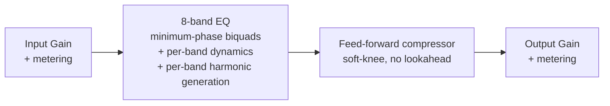

# Zero EQ

> **AI-assisted project.** This codebase was created with [Claude](https://claude.com/claude-code)
> (Anthropic), directed and reviewed by a human author. The filter maths has been checked
> against the RBJ/Butterworth cookbook formulas, and the DSP against real audio, using
> throwaway numeric test harnesses that push real signals through the actual shipped processor
> class rather than just checking static curves (including FFT checks of the harmonics the
> Harmonic character generates, band by band). `pluginval` passes clean on VST3 and passes on
> AU with two known benign warnings, and it's been loaded and hosted successfully in REAPER.
> It has **not** been used on real hardware in a live signal chain yet, so check it over before
> you put it on live gear. The details are under Status, further down.

Zero EQ is a parametric EQ and compressor plugin (VST3/AU, built with JUCE) that adds no
latency at all, so you can track and monitor through it.

**Video:** [What it does, in 45 seconds](https://www.youtube.com/watch?v=lhbbMLN6E6g)

**Try it in the browser:** [zero-eq-sim.allan-sargeant.workers.dev](https://zero-eq-sim.allan-sargeant.workers.dev).
It's the plugin's own DSP compiled to WebAssembly, with built-in signal sources and file
playback, and the audio never leaves your browser. See [`web/`](web/README.md).


*An actual screenshot of the Standalone build on the "Warm Bus (Harmonic)" factory preset: a
30 Hz high-pass, a broad presence lift and a high roll-off, with the compressor at 2:1. The
standalone wrapper's own menu bar is cropped off, so what's left is the plugin editor as a host
shows it.*

<!-- downloads:start -->

## Download

**[v0.8.2](https://github.com/stoatworks-labs/zero-eq/releases/tag/v0.8.2)** — prebuilt for macOS, Windows and Linux. Pick your platform:

<details>
<summary><b>macOS</b> — Universal (Apple Silicon + Intel)</summary>

| Build | Download | Size |
| --- | --- | --- |
| Universal (Apple Silicon + Intel) · .dmg disk image | [`zero-eq-0.8.2-macos-universal.dmg`](https://github.com/stoatworks-labs/zero-eq/releases/download/v0.8.2/zero-eq-0.8.2-macos-universal.dmg) | 11 MB |
| Universal (Apple Silicon + Intel) · .pkg installer | [`zero-eq-0.8.2-macos-universal.pkg`](https://github.com/stoatworks-labs/zero-eq/releases/download/v0.8.2/zero-eq-0.8.2-macos-universal.pkg) | 11 MB |
| Universal (Apple Silicon + Intel) · .zip archive | [`zero-eq-macos-universal.zip`](https://github.com/stoatworks-labs/zero-eq/releases/latest/download/zero-eq-macos-universal.zip) | 11 MB |

</details>

<details>
<summary><b>Windows</b> — x64, ARM64</summary>

| Build | Download | Size |
| --- | --- | --- |
| x64 · .exe installer | [`zero-eq-0.8.2-windows-x86_64-setup.exe`](https://github.com/stoatworks-labs/zero-eq/releases/download/v0.8.2/zero-eq-0.8.2-windows-x86_64-setup.exe) | 3.0 MB |
| ARM64 · .exe installer | [`zero-eq-0.8.2-windows-aarch64-setup.exe`](https://github.com/stoatworks-labs/zero-eq/releases/download/v0.8.2/zero-eq-0.8.2-windows-aarch64-setup.exe) | 2.7 MB |
| x64 · .zip archive | [`zero-eq-windows-x86_64.zip`](https://github.com/stoatworks-labs/zero-eq/releases/latest/download/zero-eq-windows-x86_64.zip) | 5.6 MB |
| ARM64 · .zip archive | [`zero-eq-windows-aarch64.zip`](https://github.com/stoatworks-labs/zero-eq/releases/latest/download/zero-eq-windows-aarch64.zip) | 5.5 MB |

</details>

<details>
<summary><b>Linux</b> — x64, ARM64</summary>

| Build | Download | Size |
| --- | --- | --- |
| x64 · .deb package (Debian/Ubuntu) | [`zero-eq_0.8.2_amd64.deb`](https://github.com/stoatworks-labs/zero-eq/releases/download/v0.8.2/zero-eq_0.8.2_amd64.deb) | 2.3 MB |
| ARM64 · .deb package (Debian/Ubuntu) | [`zero-eq_0.8.2_arm64.deb`](https://github.com/stoatworks-labs/zero-eq/releases/download/v0.8.2/zero-eq_0.8.2_arm64.deb) | 2.3 MB |
| x64 · .rpm package (Fedora/RHEL) | [`zero-eq-0.8.2-1.x86_64.rpm`](https://github.com/stoatworks-labs/zero-eq/releases/download/v0.8.2/zero-eq-0.8.2-1.x86_64.rpm) | 2.3 MB |
| ARM64 · .rpm package (Fedora/RHEL) | [`zero-eq-0.8.2-1.aarch64.rpm`](https://github.com/stoatworks-labs/zero-eq/releases/download/v0.8.2/zero-eq-0.8.2-1.aarch64.rpm) | 2.3 MB |
| x64 · .zip archive | [`zero-eq-linux-x86_64.zip`](https://github.com/stoatworks-labs/zero-eq/releases/latest/download/zero-eq-linux-x86_64.zip) | 4.5 MB |
| ARM64 · .zip archive | [`zero-eq-linux-aarch64.zip`](https://github.com/stoatworks-labs/zero-eq/releases/latest/download/zero-eq-linux-aarch64.zip) | 4.4 MB |

</details>

All builds, checksums and release notes: [github.com/stoatworks-labs/zero-eq/releases](https://github.com/stoatworks-labs/zero-eq/releases).

macOS builds are signed and notarised and open normally. The Windows builds are unsigned, so SmartScreen warns once — see [Windows SmartScreen](#windows-smartscreen) for the one-time click-through.

<!-- downloads:end -->

## Goals

- **Zero added latency**: every filter is minimum-phase IIR (biquads). There's no
  lookahead, no linear-phase FFT convolution, no oversampling and no internal buffering
  beyond the host's block size, so it's safe to track through in a live or monitoring
  signal chain.
- **Node-based curve workflow**: draggable per-band nodes over a live pre/post spectrum
  analyser. Drag = frequency/gain, scroll = Q, double-click = add/toggle a band.
- **Dynamic EQ bands**: any band with gain (Bell/Shelf/Tilt) can be switched into dynamic
  mode. It gets its own threshold/ratio/attack/release/range and behaves as a
  frequency-selective compressor (ducking when that band gets loud) or expander (boosting
  when that band gets quiet), instead of sitting at a fixed static gain. By default
  detection runs on the signal already in the chain, with no lookahead and no added
  latency, or, per band, on an external sidechain input instead.
- **Three per-band characters**: Modern (independent Q, textbook response), Vintage
  (proportional Q that widens as you add gain, approximating passive/console-style
  musical EQs such as Cranborne Audio's Harmonic EQ), and Harmonic (generates gain-driven
  even/odd harmonics from **only that band's frequency region** and sums them back in
  parallel with the dry signal, so it adds harmonics where the band is aimed instead of
  saturating the full-range signal). Vintage and Harmonic are original approximations of
  that *behaviour*, not circuit models or clones of any particular product.
- **Input/output trim** with metering, plus a post-EQ feed-forward compressor
  (soft-knee, peak/RMS detection, no lookahead, so that's zero added latency too).
- **Presets**: 7 factory presets covering every feature area (static EQ shaping,
  dynamic EQ, harmonic generation, compressor-forward), plus saving and loading your own
  presets in the standard per-user preset directory. The factory presets double as the
  plugin's VST3/AU host "program" list.
- **Ballistics-accurate metering**: the input/output meters combine a fast peak read, a
  slower VU-style integrating level, a 4x-oversampled true-peak estimate that catches
  inter-sample peaks a plain sample read would miss, and a held clip indicator, all on a
  read-only side path that can't add latency to the signal being processed.

## Roadmap

- [x] **Dynamic EQ bands**: shipped. Per-band threshold/ratio/attack/release/range,
  selectable Downward (duck) or Upward (boost) direction.
- [x] **Harmonic-based EQ**: shipped. A third per-band character that generates
  gain-driven even/odd harmonics from only the band's own frequency region and sums
  them back in parallel, with a per-band blend control between the two harmonic
  families.
- [x] **Preset system**: shipped. 7 factory presets plus user preset save/load.
- [x] **Ballistics-accurate metering**: shipped. Peak, VU, true-peak-estimate, and
  held clip indication on the input/output meters, replacing the earlier raw
  peak-only reads.
- [x] **External sidechain input for dynamic EQ**: shipped. An optional stereo
  sidechain bus, with a per-band toggle so any dynamic band can detect against that
  external signal instead of the internal chain.

All five went in without breaking the zero-added-latency guarantee, which is the reason this
plugin exists. Nothing's queued for next; it'll be whatever comes along that actually needs
doing.

## Signal chain



Each EQ band's own dynamic detector reads the signal as it arrives at that band's position in
the chain (after every earlier band, before this one) and moves that band's gain in real time.
The Harmonic character then runs a small parallel branch off that same point: the band's
frequency region is split out and shaped, and only the harmonics that shaping made are summed
back into the main path, so a Harmonic band colours the frequencies it's aimed at and leaves
the rest of the spectrum alone. It's still one pass through the chain, with no lookahead
anywhere.

## Dynamic EQ visual feedback

Dynamic bands get three layered visual cues on the main curve, so you can see what's actually
happening without opening the band panel:

- **Range envelope**: a soft shaded region showing the full swing a dynamic band could
  reach (static gain out to its configured Range, in its Downward/Upward direction).
  It only depends on the band's own settings, so it's visible even on silence.
- **Live curve**: a second curve, drawn on top of the static one, showing the actual
  instantaneous total gain (static + live dynamic delta) across the whole spectrum. It
  moves in real time as the signal pushes each dynamic band's detector, and the gap
  between it and the static curve is filled in so you can see the current deviation at a
  glance.
- **Node engagement glow**: each dynamic band's node ring brightens and thickens in
  proportion to how hard it's working (current delta relative to its Range), so an idle
  dynamic band shows as a faint outline and one that's busy ducking or boosting glows.

## Building

Requires CMake 3.22+ and a C++20 compiler (Xcode Command Line Tools on macOS).
JUCE is fetched automatically via CMake `FetchContent` on first configure.

```sh
cmake -B build -G Ninja -DCMAKE_BUILD_TYPE=Release
cmake --build build
```

Build products (VST3 / AU / Standalone) land in `build/ZeroEQ_artefacts/`.

## EQ bands

Each of the 8 bands supports Bell, Low Shelf, High Shelf, High Pass, Low Pass, Notch,
Band Pass and Tilt Shelf, with a selectable slope (12/24/36/48 dB/oct) for the HP/LP
types and a Modern/Vintage/Harmonic character switch for the rest.

Bell/Shelf/Tilt bands can also be switched into **dynamic mode**: threshold, ratio, attack,
release and a max-range clamp, with a Downward (duck) or Upward (boost) direction. The detector
filters a copy of the signal through an analysis shape to suit the band type (band-pass at the
band's freq/Q for Bell/Tilt, high-pass at the corner for High Shelf, low-pass at the corner for
Low Shelf) to isolate "the region this band affects," then envelope-follows that to drive the
gain. It's a practical way of isolating a band's region, and I'm not claiming it matches the
detection algorithm of any particular commercial dynamic EQ.

Each dynamic band also has its own **Sidechain** toggle. Leave it off and the band detects
against the signal already in the chain (the default); turn it on and it detects against the
plugin's dedicated stereo sidechain input bus instead (handy for, say, ducking a bed track off
a separate voice input). Whenever the host hasn't actually connected the sidechain bus, the
toggle falls back to internal detection by itself rather than detecting against silence, and
its label changes to "Sidechain (n/c)" so you can see that from the GUI. The sidechain bus adds
no channels to the main signal path and never writes to it. It's a read-only detection input,
so it doesn't touch the zero-added-latency guarantee either.

The **Harmonic** character blends between two waveshapers driven by how much gain the band is
applying (a band left at 0dB stays transparent even in Harmonic mode). One is an asymmetric
quadratic shaper that generates warm, tube-like even harmonics (plus a DC blocker, since
asymmetric shaping introduces a DC offset), and the other is a tanh shaper that generates
grittier, transistor-like odd harmonics. A per-band blend slider crossfades between them. Both
use first-order antiderivative anti-aliasing (ADAA) rather than oversampling: the waveshaper's
antiderivative is evaluated across the current and previous sample instead of the raw function
at the current sample, which suppresses aliasing from the nonlinearity without needing
lookahead or extra latency.

The important bit is that the shaper is **fed only that band's spectral region**, not the
full-range signal. The band's audio is split off through the same region-isolation filter the
dynamic detector uses (band-pass at freq/Q for Bell/Tilt, high-pass at the corner for High
Shelf, low-pass for Low Shelf) and saturated, and then only the *generated* harmonic content
(the shaped signal minus the isolated region) is summed back into the dry path. That parallel
structure is what makes this a harmonic *EQ* rather than a saturator behind a filter. A
Harmonic bell at 5 kHz adds harmonics derived from the 5 kHz region and leaves a bass note
passing through the same band untouched, and because only the difference is summed, the band's
own level doesn't change.

**Drive is tied to the band's gain** (`|gain| / 12`, clamped) rather than being a control of
its own. A Harmonic band at 0dB is fully transparent, and you hit full drive at ±12dB. That
keeps the character honest (no harmonics without an EQ move), but it does mean you can't dial
in heavy harmonics on a modest boost at the moment. Roughly, measured on a bell at Q=1 with the
even-leaning blend, the 2nd harmonic sits about 28dB below the fundamental at +3dB gain, 15dB
below at +6dB, and 6dB below at +9dB. +12dB is meant to be extreme.

## Presets

7 factory presets, each starting from a full reset-to-defaults so every parameter not
mentioned below stays at its default:

| Preset | Showcases |
| --- | --- |
| Init | Flat/default state, useful as a starting point or reference |
| Vocal Presence | Static EQ shaping — low-mid cut, presence bump, air shelf |
| De-Esser (Dynamic) | A single dynamic downward band tuned to catch sibilance |
| Warm Bus (Harmonic) | Harmonic character on two bands (even-leaning low end, odd-leaning top) plus gentle bus compression — subtle by design, both bands sit at low gain and therefore low drive |
| Podcast Voice | HPF + presence + a dynamic band taming harshness + compressor, combined |
| Broadcast Loudness | Compressor-forward: higher ratio, faster attack/release, auto makeup |
| Telephone / Lo-Fi | Aggressive band-limiting plus an odd-leaning Harmonic band driven around mid-range, for creative use |

User presets save to the standard per-user preset directory
(`~/Library/Audio/Presets/Allan Sargeant/Zero EQ/` on macOS) as plain APVTS-state XML. That's
the same save/restore path a host already uses for session recall, so there's no separate
preset format to keep in step. The factory presets also drive the plugin's VST3/AU "program"
list, so a host's own program-switching UI works too.

## Metering

Input and output each get their own read-only `LevelMeter` instance sitting after that
stage's gain trim. It reads a copy of the buffer and never touches the signal itself, so
nothing it does can add latency:

- **Peak**: instant attack, ~20dB/s exponential release. It's an approximation of a fast
  peak meter, and I'm not claiming it matches any particular broadcast PPM's spec.
- **VU**: a one-pole RMS-based integrator tuned to take ~300ms to reach 99% of a step,
  approximating classic VU ballistics (not a model of a meter needle's physics).
- **True peak**: a lightweight 4x-oversampled estimate using Catmull-Rom cubic
  interpolation between samples, which catches inter-sample peaks a plain sample-peak
  read misses. It's a practical estimate, not a full ITU-R BS.1770-compliant filter.
- **Clip indicator**: held for ~1.5s so a brief clip stays visible, and triggered a small
  headroom margin below 0dBFS rather than by a hard `>= 1.0` check. A nominally
  unity-gain stage isn't always bit-exact 1.0 after a normalised-parameter round trip,
  so a razor-edge threshold can miss a sample that really is at full scale.

## Windows SmartScreen

The released plugins are **Developer ID-signed and notarised** on macOS, so your host loads
them with no quarantine step and no failed validation. The Windows binaries are **not**
code-signed.

- **macOS**: nothing to do. Copy the bundle into place and rescan.
- **Windows**: plugin files aren't gated the way `.exe` files are, so your host loads
  them normally. The **installer** trips SmartScreen: **More info** → **Run anyway**.
- **Linux**: no signing gate.

Per-artifact steps, self-signing and checksum verification:
**[docs/UNSIGNED.md](docs/UNSIGNED.md)**.

## Status

Phase 7: the DSP engine, dynamic EQ (with optional external sidechain detection),
band-isolated harmonic generation, presets, ballistics-accurate metering and the full
interactive GUI (spectrum analyser, draggable curve, preset bar, band/compressor/IO panels,
live dynamic-gain indicators).

It's verified with `pluginval` (VST3 + AU, strictness 5: VST3 clean, AU passes with two known
benign warnings, see below), hosted successfully in REAPER, and checked against real audio
through the actual shipped processor class. That last part covers:

- a two-tone FFT check confirming the Harmonic character generates harmonics from only its
  own band's region while leaving an out-of-band tone untouched (91dB of selectivity
  measured, with the out-of-band fundamental passing through within 0.01dB), that a
  pure-odd blend produces odd harmonics and no even ones, and that a Harmonic band at 0dB
  gain is fully transparent;
- a full sweep confirming every factory preset applies correctly, produces finite (no NaN)
  audio and reports zero added latency;
- a metering pass confirming that peak attack/release timing, VU ballistics, true-peak
  inter-sample detection and clip-indicator hold time all match their intended behaviour on
  known test signals;
- and a sidechain pass confirming a dynamic band tracks the external sidechain signal (not
  the internal one) when its toggle is on, tracks the internal signal steadily when it's
  off, and falls back to internal detection cleanly when sidechain audio isn't actually
  connected.

The open items below are what's still outstanding.

**Known benign AU warnings**: two `pluginval` warnings turn up every time on the AU build,
while every other check passes clean, and so does Apple's own `auval` validator (exit
code 0):

- *"Disabling non-main buses failed"*: a documented JUCE/AudioUnit interaction. AUv2's
  bus-disable semantics for auxiliary/sidechain input buses don't round-trip the way
  pluginval expects, whatever the plugin does; it's a widely reported quirk for AU
  plugins carrying a sidechain bus.
- *"Current program is -1"*: the AU wrapper reports no factory preset as selected until
  a host selects one, even though `getCurrentProgram()` returns a valid index and the
  factory preset list is fully populated and working.

### Known limitations / next steps

- [ ] Not yet tested against real (non-silent) audio hardware in a live signal chain.
- No linear-phase mode. That's out of scope on purpose, since zero latency was the stated
  goal.

<!-- attributions:start -->
This project is built on other people's work — see [ATTRIBUTIONS.md](ATTRIBUTIONS.md).

**Licensing:** the source here is MIT, but the released binaries link JUCE 8 and are conveyed under the **AGPLv3** — see [ATTRIBUTIONS.md](ATTRIBUTIONS.md) before redistributing them.
<!-- attributions:end -->

## Licence

MIT. See [LICENSE](LICENSE).
