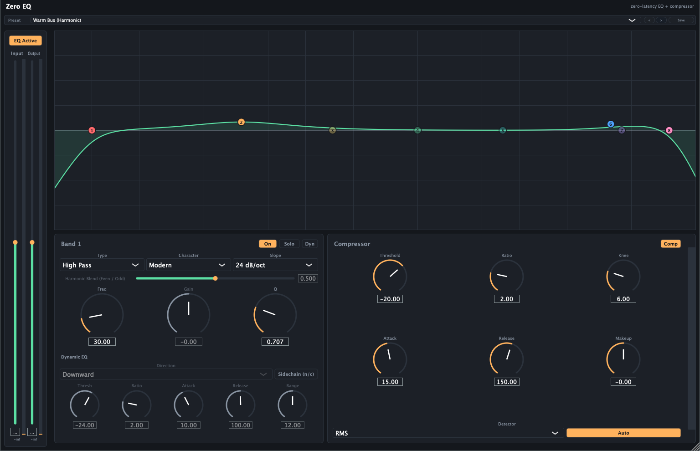

# Zero EQ user guide

Zero EQ is an 8-band parametric equaliser and compressor plugin (VST3 / AU) that adds no latency
at all, so you can track and monitor through it.

> **Before live use:** the DSP has been verified analytically and against real audio, passes
> `pluginval` and Apple's `auval`, and has been hosted in REAPER. It has **not** been used on
> real hardware in a live signal chain. Check it over before you put it on a show.

---

## Why "zero latency" matters

Most EQ plugins with a linear-phase mode pay for it with **lookahead**: the plugin delays your
audio so it can see what's coming. That's fine for mixing, but you can't sing or play through
it, because you'd hear yourself late.

Zero EQ gives that up on purpose. Every filter is minimum-phase, and there's no lookahead, no
oversampling and no internal buffering, so you can track through it and monitor through it.

The catch is permanent: there's **no linear-phase mode**, and there never will be.

---

## Installing

Build it yourself, or grab a release build. On macOS the VST3 goes to
`~/Library/Audio/Plug-Ins/VST3/Zero EQ.vst3`; the AU alongside it. Rescan plugins in your DAW.

---

## The EQ

*Everything's on one surface. Band 1 is selected below the curve, with its dynamic-EQ section
underneath and the compressor alongside, so you can see the EQ move and the gain reduction
reacting to it at the same time.*

### Working with the curve
The main display is a spectrum analyser with your EQ curve over it, and a draggable node for
each band.

- **Drag a node**: frequency (left/right) and gain (up/down)
- **Scroll on a node**: Q, i.e. how wide or narrow the band is
- **Double-click**: add a band, or toggle one on and off

### Band types
**Bell** boosts or cuts around a centre frequency. **Low/High Shelf** lift or drop everything
below/above a corner. **High Pass / Low Pass** remove everything below/above a corner
entirely. **Notch** cuts sharply at one frequency (for hum or a ringing resonance).
**Band Pass** keeps only a region. **Tilt Shelf** tilts the whole spectrum about a pivot.

For High Pass and Low Pass you also get a **Slope**: 12, 24, 36 or 48 dB/octave, which is how
steeply it cuts.

### Character — the interesting control
Each band has a **Character**, and it changes how the band behaves, not just how it sounds:

- **Modern**: the textbook parametric. Q is independent of gain, so a narrow band stays
  narrow however much you boost.
- **Vintage**: proportional Q. The more gain you apply, the wider the band gets, the way
  passive and console EQs behave. Broad musical moves feel more natural; surgical cuts are
  harder.
- **Harmonic**: Modern's response, **plus** harmonics generated from that band's own
  frequency region and mixed back in. Boosting adds warmth or grit rather than just level.

**Harmonic Blend** (it only matters on Harmonic) sweeps from even harmonics at 0 (tube-like
warmth) to odd at 1 (transistor-like grit).

A Harmonic band at 0 dB gain is completely transparent, so the character costs nothing until
you use it.

### Solo
Soloing a band lets you hear only what that band is affecting, which is very handy when you're
hunting down a resonance. **Soloing one band mutes the others.**

---

## Dynamic EQ

Any band with gain (Bell, shelves, Tilt) can be switched to **dynamic**, which means it only
acts when the audio in its own region needs it.

- **Downward**: pull back when the region gets loud. A de-esser is the classic case: the
  band dips only when there's actually sibilance, and leaves the rest of the vocal alone.
- **Upward**: lift when the region gets quiet.

Controls: **Threshold** (the level it reacts around), **Ratio** (how hard), **Attack** and
**Release** (how fast in and out), **Range** (the most it may move).

### Sidechain
Switch a dynamic band to **Sidechain** and it reacts to an *external* input instead of the
audio passing through. That's how you duck music under a voice at particular frequencies
rather than pulling the whole track down.

If your host isn't feeding the sidechain input, the band falls back to listening to the
internal signal rather than failing.

---

## Compressor

A feed-forward compressor after the EQ.

**Threshold**: where it starts working. **Ratio**: how hard. **Attack / Release**: how fast.
**Knee**: how gradually compression eases in around the threshold; a wide knee is gentler and
less obvious.

**Detector** picks how loudness is measured: **Peak** catches short transients, and **RMS**
(the default) follows average loudness and sounds more natural on programme material.

**Auto Makeup is on by default** and estimates how much level to give back. While it's on,
**the manual Makeup control does nothing**, so turn Auto off to set makeup yourself. Auto is
gentle on purpose and doesn't try to restore the full peak level.

---

## Metering

Three readings, each answering a different question:

- **Peak**: the highest sample. It rises instantly and falls back gradually, so you can
  actually read a transient.
- **True Peak**: the highest point of the *reconstructed* waveform, including between
  samples. This is the one that matters for clipping: a signal can read safe on sample peak
  and still clip on conversion or in a lossy encoder.
- **VU**: slow and averaged; it tracks perceived loudness.

The **clip indicator** trips slightly below 0 dBFS (-0.1 dB) and holds for about 1.5 seconds,
so a brief clip doesn't vanish before you see it.

---

## Presets

Factory presets are on the preset bar, and you can save your own. Every factory preset has been
swept to confirm it applies correctly, produces no NaN audio and reports zero added latency.

---

## Known quirks — not bugs

**Two `pluginval` warnings on the AU build** are expected and benign: *"Disabling non-main
buses failed"* (a documented JUCE/AudioUnit interaction for plugins with a sidechain bus) and
*"Current program is -1"* (the AU wrapper reports no preset selected until a host picks one).
Apple's own `auval` passes clean.

---

## Troubleshooting

**Gain does nothing on a band.** High Pass, Low Pass, Notch and Band Pass have no gain. They
remove or keep a region rather than changing its level. Use a Bell or shelf.

**Slope does nothing.** It only applies to High Pass and Low Pass.

**Harmonic Blend does nothing.** The band's Character isn't set to Harmonic, or its gain is at
0 dB (where a Harmonic band is meant to be transparent).

**Makeup gain does nothing.** Auto Makeup is on. Turn it off.

**A dynamic band isn't reacting to my sidechain.** Check your host is actually feeding the
plugin's sidechain bus; how you route it depends on the host. Without it the band falls back
to the internal signal, which looks like "sidechain isn't working".
